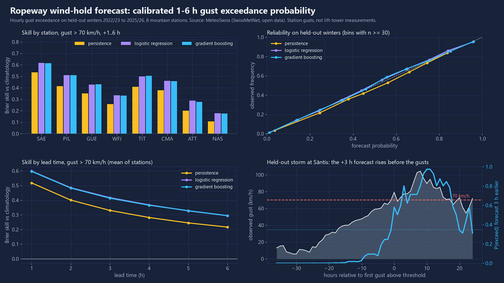
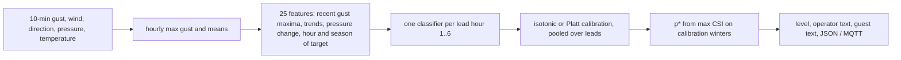

# ropeway-wind-stop-forecast

Open-source forecast of the probability that gusts exceed a lift's wind-hold limit in each of the next 1 to 6 hours, with operator and guest messages and a JSON/MQTT feed.



## What it does

- Predicts `P(hourly max gust at t+k > threshold)` for k = 1..6 h from the last 24 h of wind, pressure and temperature at a mountain station.
- Calibrates the probabilities on separate winters and tunes one operating probability `p*` (maximum critical success index) per station and threshold.
- Turns the six probabilities into a level (`ok`, `watch`, `hold`), an operator sentence, guest text in en/de/fr/it, and a JSON record that can be published over MQTT.
- Compares against two baselines: climatology (month x hour) and calibrated persistence.

Thresholds are illustrative defaults (60 / 70 / 80 km/h in `ropeway_wind_stop_forecast/data/lift_types.json`). They are not a regulation and not any operator's licence limit. Pass `--threshold` with your own value.

## Results

Held-out winters 2022/23 to 2025/26, never used for fitting, calibration or tuning. Training: winters 2010/11 to 2018/19. Calibration and `p*`: 2019/20 to 2021/22. Eight stations, lead times 1 to 6 h pooled; skill values are the mean over stations. `skill vs clim` = 1 - Brier / Brier of climatology; `skill vs pers` likewise against persistence. POD and false-alarm ratio are pooled over all station-hours at each model's own `p*`. Storm onset = first gust above the threshold after 6 hours without one (1233 onsets at 70 km/h); "warned" means the model was at or above `p*` for that hour at some issue time 1 to 6 h before.

| Threshold | Model | Skill vs clim | Skill vs pers | Calibration error | POD | False-alarm ratio | Onsets warned | Mean lead (h) |
|---|---|---|---|---|---|---|---|---|
| 60 km/h | persistence | 0.370 | 0.000 | 0.010 | 0.716 | 0.284 | 0 / 1662 | n/a |
| 60 km/h | logistic regression | 0.454 | 0.139 | 0.007 | 0.747 | 0.303 | 378 / 1662 | 3.3 |
| 60 km/h | gradient boosting | 0.454 | 0.140 | 0.008 | 0.751 | 0.311 | 452 / 1662 | 3.6 |
| 70 km/h | persistence | 0.332 | 0.000 | 0.008 | 0.677 | 0.322 | 0 / 1233 | n/a |
| 70 km/h | logistic regression | 0.415 | 0.130 | 0.005 | 0.716 | 0.344 | 309 / 1233 | 3.6 |
| 70 km/h | gradient boosting | 0.413 | 0.128 | 0.006 | 0.710 | 0.347 | 322 / 1233 | 3.5 |
| 80 km/h | persistence | 0.273 | 0.000 | 0.006 | 0.622 | 0.377 | 0 / 914 | n/a |
| 80 km/h | logistic regression | 0.359 | 0.124 | 0.004 | 0.650 | 0.392 | 232 / 914 | 2.9 |
| 80 km/h | gradient boosting | 0.352 | 0.115 | 0.005 | 0.667 | 0.406 | 299 / 914 | 3.2 |

Climatology is the reference (skill 0 by definition). Its CSI-tuned `p*` is so low that it warns almost constantly (false-alarm ratio 0.81 to 0.91), so its onset numbers are omitted. All numbers come from `results/metrics.csv`, reproduced by the demo.

Reading the table:

- The learned models beat persistence at every lead time and threshold, but the margin is modest (+0.12 to +0.14 Brier skill). Most of the skill over climatology comes from "it is already windy".
- Gradient boosting is not better than logistic regression here.
- Persistence cannot warn before an onset by construction. The learned models catch about a quarter to a third of onsets at least 1 h ahead, with roughly a third of warnings false. Onsets are the hard part.
- Stations with rare exceedances (Weissfluhjoch, Les Attelas, Naluns at 70 km/h) have far fewer test events and lower skill. Per-station values are in `results/metrics.csv`; skill is reported as n/a below 30 test events.

Per-station skill, reliability, skill by lead and one held-out storm are in the figure above. Example feed record (`docs/example_feed.json`): a replayed held-out hour at Säntis with operator text and four guest languages.

## Quick start

```bash
pip install -e ".[dev]"            # optional: ".[mqtt]" for MQTT publishing
python -m ropeway_wind_stop_forecast demo --fast     # about 20 s: 2 stations, no gradient boosting
python -m ropeway_wind_stop_forecast demo            # full run, about 4 min on 4 cores; rewrites results/ and docs/
python -m ropeway_wind_stop_forecast forecast --station SAE --threshold 70 --at 2023-12-19T13:00
python -m ropeway_wind_stop_forecast forecast --station SAE --threshold 70          # live MeteoSwiss hours, needs internet
python -m ropeway_wind_stop_forecast forecast --station SAE --mqtt-host localhost   # also publish to MQTT
```

`--at` replays a past hour using only pre-2019 training winters. Without `--at` the model is trained on all winters except the calibration ones and fed the latest hours from the MeteoSwiss open-data portal. `fetch-met` rebuilds the bundled fixture (a large download of 10-minute files; not needed to run the demo).

## How it works



- Issue time is the end of the last observed hour. Features only use data up to then (a test shifts future values and checks the features do not move).
- Hourly layout: gust is the maximum of the 10-minute gust peaks, with at least 4 of 6 values present.
- Models: logistic regression and a histogram gradient-boosting classifier from scikit-learn, one per lead hour.
- Levels: `hold` when `P >= p*`, `watch` when `P >= 0.5 p*`, otherwise `ok`.

## Data sources

Weather data: MeteoSwiss, automatic weather stations SwissMetNet, 10-minute values, open data at https://data.geo.admin.ch/ch.meteoschweiz.ogd-smn. Licence: CC BY (as stated in the collection metadata on data.geo.admin.ch, checked 2026-11-09), so the source must be cited: **Source: MeteoSwiss.** The bundled `ropeway_wind_stop_forecast/data/winters_hourly.csv.gz` is a derived hourly November-to-April extract (about 550 000 station-hours, winters 2010/11 to 2025/26 plus a few days of November 2026) of gust, mean wind, direction, pressure and temperature at: Säntis, Pilatus, Gütsch (Andermatt), Weissfluhjoch, Titlis, Crap Masegn, Les Attelas and Naluns/Schlivera.

Live context only (parsers included, not used for training): SLF IMIS measurement API and the Open-Meteo forecast API.

## What is not verified yet

- These are weather-station gusts at ski-area summits, not wind measured at lift towers or cabins. Exposure differs, so a tower may see more or less wind.
- The thresholds are illustrative. No comparison with real wind-hold decisions or logs exists; operators stop for reasons other than a single gust limit.
- Only winters at eight stations were tested. Results at other sites, or at thresholds far from 60 to 80 km/h, are unknown.
- The operating point `p*` maximises CSI, which says nothing about the real cost of a false hold versus a missed one.
- The live path (`forecast` without `--at`, MQTT publishing) is exercised with a mocked client in tests, not against a real broker, and not against a live lift.
- Guest texts are short drafts in four languages and have not been reviewed by native speakers or an operator.
- This is a decision aid, not a safety system. It must not replace the operator's own wind monitoring and rules.

## Licence

MIT, Copyright (c) 2026 Victor Bonilla.
